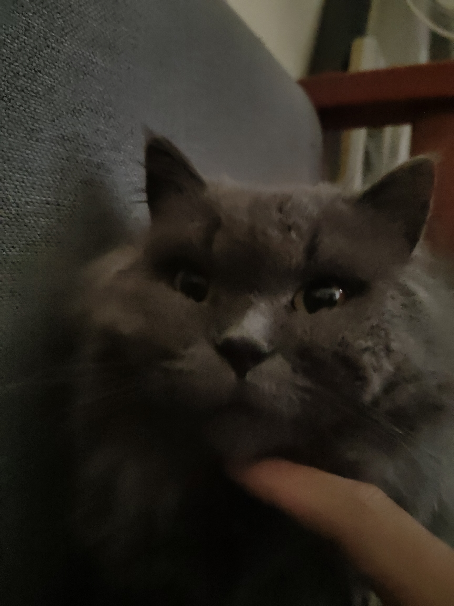

# Lazy Cat

**Alright, let’s do this Q&A in the most straight-talking, no-nonsense, cut-to-the-chase way possible.**

| Question                                    | Answer                                                                     |
|---------------------------------------------|----------------------------------------------------------------------------|
| What is this?                               | 	A lib mod specifically for Datagen                                         |
| How was it done?                            | I love Builder                                                             |
| What can it do?                             | 	Quickly generate data content                                              |
| Is it relevant to me?                       | 	Generally speaking, no                                                     |
| Why did you make this project?	              | Because I'm lazy.                                                          |
| How do I use it?	                            | The design philosophy is that you can get started without reading any docs |
| So basically there are no docs	              | How did you know                                                           |
| So you're saying it's for development only? | 	Yep                                                                        |

## Supported Modules

- Applied Energistics 2
    - Charger
    - Entropy
    - Inscriber
- Re:Avaritia
    - Compressor
    - Extreme Crafting:
        - Sculk
        - Nether
        - End
        - Extreme
- Farmer's Delight 26 Neo Ver
    - Cooking Pot
    - Cutting Board
- Mekanism
    - Activating
    - Centrifuging
    - Chemical Crystallizer
    - Chemical Conversion
    - Chemical Dissolution
    - Chemical Infuser
    - Combiner
    - Compressing
    - Crushing
    - Electrolysis
    - Energy Conversion
    - Enriching
    - Evaporating
    - Injecting
    - Metallurgic Infusing
    - Nucleosynthesizing
    - Oxidizing
    - Painting
    - Pigment Extracting
    - Pressurized Reaction
    - Purifying
    - Rotary
    - Sawmill
    - Smelting
    - Washing
- Minecraft
    - Blasting
    - Campfire Cooking
    - Custom Crafting
    - Smelting
    - Smoking
    - Workerbench
    - Smithing Transform Build
    - Smithing Trim
    - Special
    - Stonecutter
    - Transmute
- Thaumaturge
    - Arcane Workbench
    - Crucible
    - Infusion
    - Infusion Enchantment

## Real Lazy Cat

